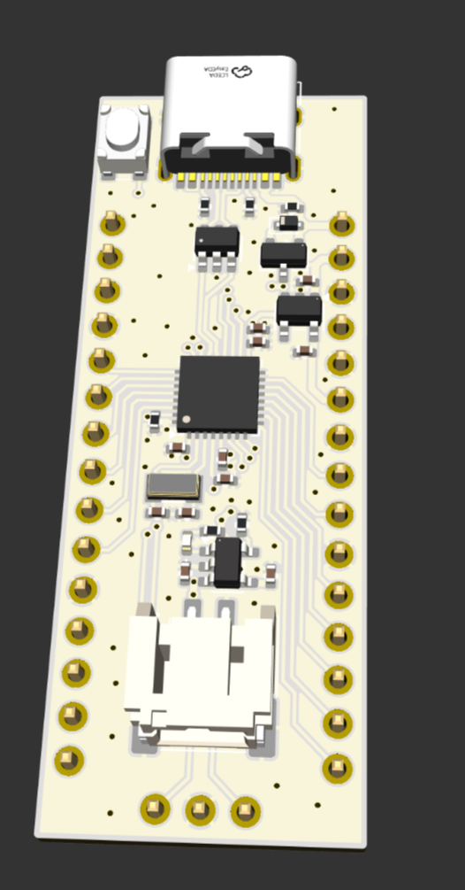
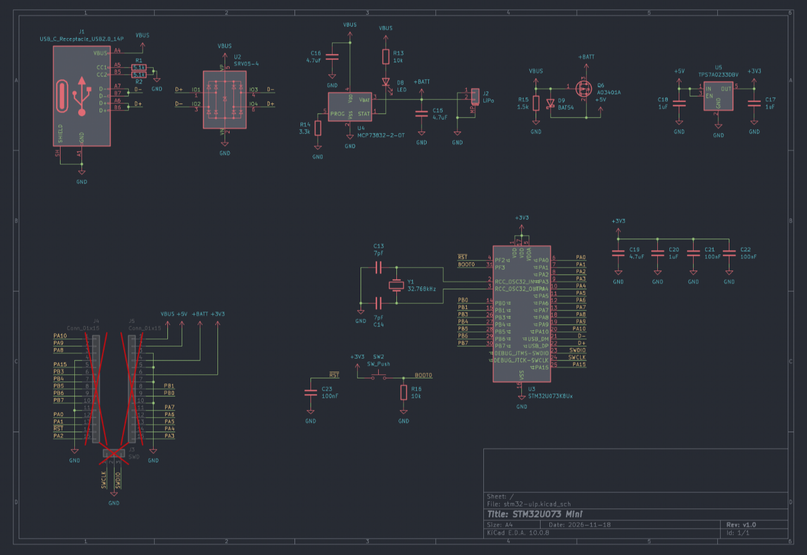
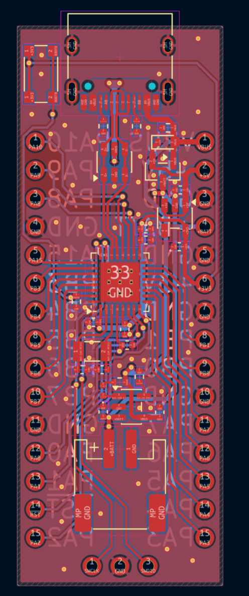

# STM32U073 Mini



A small STM32U073 devboard made for low power stuff. It runs off USB-C or a LiPo, and has a LiPo charging circuit. The whole power chain is picked so the board idles at basically nothing when the MCU is asleep.

The STM32U0 is stm's ulp stm32. With a 56MHz Cortex-M0+, 64KB flash, and 40KB SRAM, crystal-less USB, and ~100nA sleep. The board uses a STM32U073K8Ux chip, with 3.3V from a ldo with 25nA Iq.

There's a 32.768kHz crystal for the RTC, so you can sleep for hours and still wake up on time.



This is made for very low-power projects, such as eink control with lots of sleep.

### Features

- [STM32U073K8](https://www.st.com/en/microcontrollers-microprocessors/stm32u073k8.html)
    - Arm Cortex-M0+ @ 56MHz
    - 64KB Flash, 40KB SRAM
    - USB full speed, crystal-less
    - 12bit ADC, comparators, op-amp, LCD controller
- 32.768kHz LSE crystal
- USB-C, programmable over the built-in USB DFU bootloader
- BOOT0 button
- LiPo charging with power path
- SWD header
- 2x15 pin headers
- 18.5x50.3mm



### Pinout

| Pin | Left (J4) | Right (J5) |
| --- | --------- | ---------- |
| 1   | PA10      | VBUS       |
| 2   | PA9       | 5V         |
| 3   | PA8       | GND        |
| 4   | GND       | BATT       |
| 5   | PA15      | GND        |
| 6   | PB3       | 3V3        |
| 7   | PB4       | GND        |
| 8   | PB5       | PB1        |
| 9   | PB6       | PB0        |
| 10  | PB7       | GND        |
| 11  | GND       | PA7        |
| 12  | PA0       | PA6        |
| 13  | PA1       | PA5        |
| 14  | RST       | PA4        |
| 15  | PA2       | PA3        |

SWD header: SWCLK, GND, SWDIO

### Programming

Hold BOOT0, plug it in (or tap RST), and it shows up as a DFU device. Then flash with `dfu-util` or STM32CubeProgrammer:

```
$ dfu-util -a 0 -s 0x08000000:leave -D firmware.bin
```

Or use any SWD probe on the 3 pin header.

### Hardware

KiCad files are in `hardware/`, production files are in `hardware/production/`.

### BOM

| Item | Price | Link |
| --- | --- | --- |
| PCB | $6.15 | jlcpcb.com |
| PCBA | $103.46 | Same |
| Shipping | $23.52 | Same |
| Total | $133.13 | - |
